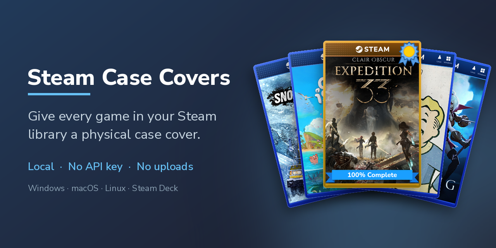
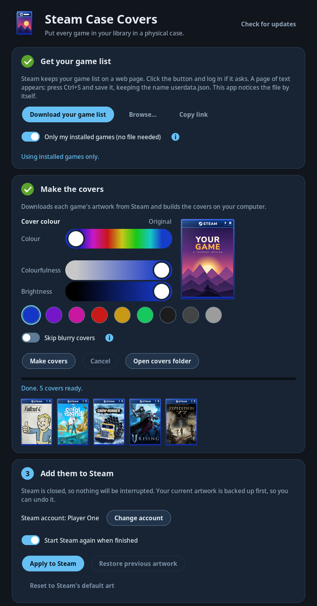
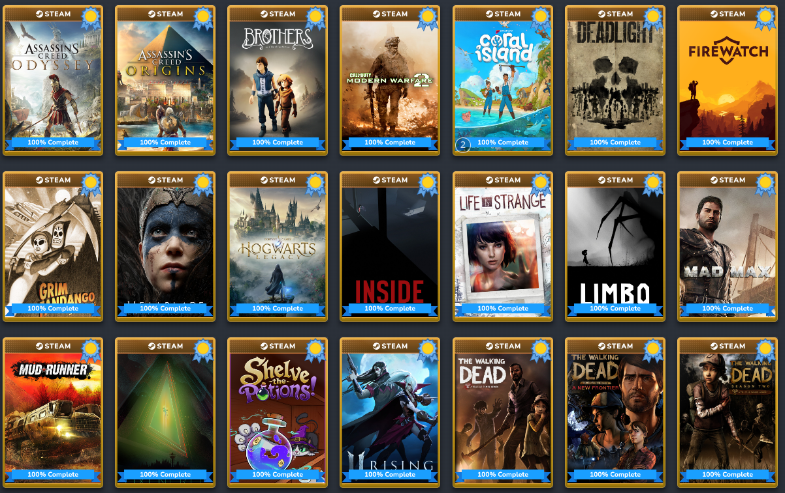
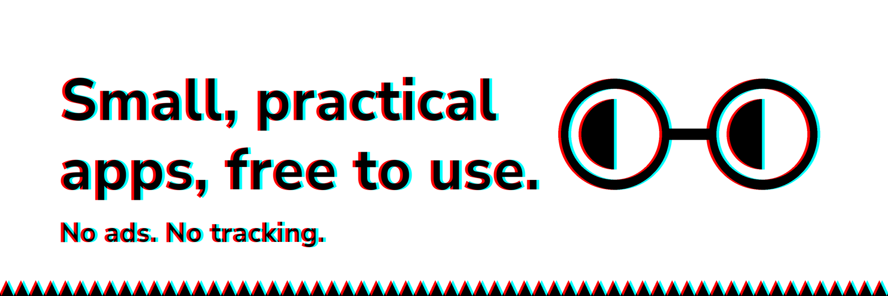

<p align="center">
  <a href="https://github.com/diegobergonsi/steam-case-covers/raw/main/assets/preview.png"></a>
</p>

<h1 align="center">steam-case-covers</h1>

<p align="center">
  Give every game in your Steam library a "physical copy" case cover.<br>
  Everything runs on your computer: no login, no API key, no uploads.
</p>

<p align="center">
  <a href="https://github.com/diegobergonsi/steam-case-covers/releases"><b>DOWNLOAD</b></a> ·
  <a href="https://discord.gg/JQMjAPWHCT"><b>DISCORD</b></a>
</p>

<p align="center">
  <a href="#install">Install</a> ·
  <a href="#how-it-works">How it works</a> ·
  <a href="#features">Features</a> ·
  <a href="#safety">Safety</a> ·
  <a href="#steam-compatibility">Steam compatibility</a> ·
  <a href="#command-line">Command line</a> ·
  <a href="#faq">FAQ</a> ·
  <a href="#feedback-and-bugs">Feedback and bugs</a> ·
  <a href="#support-the-project">Support</a>
</p>

<p align="center">
  <a href="https://github.com/diegobergonsi/steam-case-covers/raw/main/assets/screenshot.png"></a>
  <br>
  <em>The whole app: three steps, no terminal.</em>
</p>

<p align="center">
  <em>
    This project is not affiliated with Valve Corporation, Microsoft or any game publisher.
    Steam and Windows are trademarks of their respective owners. See <a href="docs/THIRD_PARTY.md">THIRD_PARTY.md</a>.
  </em>
</p>

## What is it?

Steam shows your library as tall portrait cards. This tool puts each game's own artwork inside a "box" (blue by default, or any colour and shade you pick, from vivid to dark grey and black) with a Steam banner and platform badges, like a boxed console game, and installs the result as your custom artwork.

The artwork comes from Steam's own servers. The covers are built on your computer and stay there.

<p align="center">
  <a href="https://github.com/diegobergonsi/steam-case-covers/raw/main/assets/library-mixed.png"></a>
  <br>
  <em>How the covers look inside Steam. Leaf it Alone comes from a family member's library, so it has the green corner. Coral Island is owned in both libraries, so it does not (the small “2” is Steam's own badge). Coral Island and V Rising are at 100%, here with the gold border option.</em>
</p>

<a id="install"></a>

## 📥 Install

<details>
<summary><b>Windows</b></summary>

Download `SteamCaseCovers-windows.exe` from the [Releases page](https://github.com/diegobergonsi/steam-case-covers/releases) and double-click it.

If "Windows protected your PC" appears, click **More info**, then **Run anyway**. The app isn't code-signed (that costs money), which is why Windows warns you. Some antivirus tools also flag apps of this kind.

</details>

<details>
<summary><b>macOS</b></summary>

Download `SteamCaseCovers-macos.zip` from the [Releases page](https://github.com/diegobergonsi/steam-case-covers/releases) and double-click it to unzip. **Before you open the app**, run this in **Terminal** (change the path if the app isn't in Downloads), then double-click the app:

```bash
xattr -dr com.apple.quarantine ~/Downloads/SteamCaseCovers.app
```

Why: macOS blocks any app that doesn't come from a paid Apple developer (about 99 USD a year, which a free project can't justify). That command removes the "downloaded from the internet" mark, so macOS opens the app normally. The app isn't harmful or damaged, and its source code is here for anyone to read.

If you open the app first instead, macOS shows **"SteamCaseCovers" Not Opened: Apple could not verify it is free of malware**. Click **Done** (not Move to Trash), then open **System Settings**, **Privacy & Security**, scroll to **Security**, and click **Open Anyway** next to the SteamCaseCovers message (it stays for about an hour; double-click the app again to bring it back). If the app then bounces in the Dock forever with no window, **restart your Mac** and use the Terminal command above instead. On macOS 14 or older you can also right-click the app and choose **Open**.

The first time you press **Apply to Steam**, macOS may say the app isn't allowed to control Steam. Allow it in the prompt (or in **System Settings**, **Privacy & Security**), then press the button again.

macOS support is **best effort**: the author has only tested it on an Apple Silicon MacBook Air. The build is for Apple Silicon (M1 or newer). On an Intel Mac, run it [from source](#from-source).

</details>

<details>
<summary><b>Linux and Steam Deck</b></summary>

On a Steam Deck, switch to **Desktop Mode** first. The app needs a desktop window, so it doesn't run in Gaming Mode.

Download `SteamCaseCovers-linux` from the [Releases page](https://github.com/diegobergonsi/steam-case-covers/releases) and open it. On a Steam Deck a small pop-up appears: click **Launch** and the app opens.

If your file manager doesn't run it, make it executable and start it from a terminal:

```bash
chmod +x SteamCaseCovers-linux
./SteamCaseCovers-linux
```

</details>

<details id="from-source">
<summary><b>From source (any system)</b></summary>

If you'd rather not trust a download, run it from the code. It needs Python 3 and Pillow 10.3 or newer (the release builds and the automated tests use Python 3.12; older versions down to 3.8 are expected to work but are not tested).

```bash
git clone https://github.com/diegobergonsi/steam-case-covers
cd steam-case-covers
python -m pip install -r requirements.txt
python gui.py
```

On macOS and Linux, use `python3` instead of `python`. Run the tests with `python -m unittest discover -s tests`. A random-click robot that tries to break the window needs a display: `python tests/fuzz_gui.py` (on a server: `xvfb-run -a python tests/fuzz_gui.py`).

</details>

Release files come with a `SHA256SUMS` list so you can check what you downloaded. See [SECURITY.md](docs/SECURITY.md).

<a id="how-it-works"></a>

## 🔧 How it works

1. **Get your game list.** Click **Download your game list**. Your browser opens Steam: log in if it asks, and you'll land on a page of plain text. Save it (Ctrl+S, or Cmd+S on a Mac) as `userdata.json`. The app notices the file by itself. No browser opening? Click **Copy link** and paste it yourself. Or tick **Only my installed games** to skip this step: games that are not installed on this computer, including games shared by a family member, are then left out (hover the **i** next to it). On a Mac with Safari, set the format to **Page Source** when saving (or use Chrome or Firefox).
2. **Make the covers.** Optionally pick the look of the cases first: drag the Colour, Colourfulness and Brightness sliders or tap one of the nine swatches (six colours, then Black, Graphite and Silver), and the preview shows the result. Colourfulness and Brightness only go down from the original blue, so the case can be any shade from vivid to dark grey and black; the white logo and text stay white. Then click **Make covers** and wait. You can cancel and run it again later: finished covers are kept, so it picks up where it stopped. If you already made covers in another colour, the app asks before it replaces them.
3. **Add them to Steam.** Click **Apply to Steam**. If more than one Steam account is on this computer, the window shows which one will change; click **Change account** to pick another.

> [!WARNING]
> Step 3 **closes Steam for you** (any running game stops and downloads pause), adds the covers, and starts Steam again. Save your game first. The app asks before it does anything.

Changed your mind?

* **Restore previous artwork** undoes the last Apply. Press it again to go one step further back.
* **Reset to Steam's default art** removes the covers this app made. It works even if you have no backup. If it also finds custom art that this app did not make (from SteamGridDB, or set by hand in Steam), it asks whether to remove that too: **Remove only ours** keeps it, **Remove all** brings back Steam's own art everywhere. Restore undoes either.

### Optional: highlight your 100% games

Step 2 has an optional block, **Highlight my 100% games**. Games where you unlocked every achievement get a rosette at the top right, on top of the platform badges, and a "100% Complete" ribbon at the bottom. It works like step 1: the app cannot see your achievements by itself, so you save one more page from your own browser.

<p align="center">
  <a href="https://github.com/diegobergonsi/steam-case-covers/raw/main/assets/library-100.png"></a>
  <br>
  <em>Games completed at 100%, with the gold case option.</em>
</p>

1. Click **Open my games page** (or **Copy link**). Your browser opens your Steam games page, sorted by achievements. Log in if it asks and wait until your games have loaded.
2. Save it (Ctrl+S, or Cmd+S on a Mac) as **"Webpage, Complete"** in Chrome or Firefox, named `games.html`. Your browser also saves a folder next to it. The app notices the file in your Downloads folder by itself, or you can click **Browse…** and pick it.
3. Choose how those games look: **Gold case** (the whole case turns gold), **Gold border** (a gold border around the outside of the case, which becomes about 5% smaller), **Normal case with ribbon** (your case stays as it is; this is the default once a page is loaded) or **No special case**. The choice can be picked once a page is loaded. Then click **Make covers**.

> [!NOTE]
> The saved page contains a temporary login token for your Steam account. The app only reads which games are at 100%: it never uses, stores or logs the token. You can delete `games.html` and its folder once the covers are made. The app never deletes your files itself.

Good to know:

* Only games that are already in your step 1 list can be highlighted.
* Steam's page shows progress only for games where you have unlocked at least one achievement. That is why only games at 100% are marked: there are no marks for games you have only started.
* Switching the choice, or saving the page again after you finish another game and clicking **Make covers**, rebuilds only the covers that change. If you make covers without loading a page, covers that are already highlighted keep their highlight.
* The page lists most of a library but not all of it. On the author's library it listed about 99% of the covers (509 of 515): a few old, free or hidden games are not on it and cannot be highlighted.
* This was only tried with Chrome, on Linux, with Steam set to Portuguese and to English; the saved pages gave exactly the same result. Firefox is expected to save the page the same way, and the app reads the progress without depending on the language of Steam's label, but other languages and browsers were not tested. Windows and macOS were not tested either, and neither was a real touchscreen.

<a id="features"></a>

## ✨ Features

**Covers**
- For your installed games, or your whole library
- Each cover is the game's own portrait inside a case, with the Steam banner and platform badges
- Games shared through Steam Family Sharing get covers too, with a green corner and a family icon
- Optional "skip blurry covers" for games Steam has no real portrait for

**Make them yours**
- Pick the colour, colourfulness and brightness of the cases with three sliders or a ready-made swatch (black, graphite and silver included), with a live preview
- Optional: games where you unlocked every achievement get a rosette and a "100% Complete" ribbon, and, if you like, a gold case or a gold border ([how it works](#optional-highlight-your-100-games))

**Install them safely**
- One click: Steam is closed gracefully, backed up, updated and restarted
- Undo step by step, and a reset to Steam's default art
- Cancel anytime; run again to continue
- Several Steam accounts on one computer: you choose which one gets the covers

**The app itself**
- Works with the keyboard, scales on high-DPI screens and fits small screens like the Steam Deck's
- A "Check for updates" button, only when you click it: it asks GitHub for the newest version and never downloads or installs anything
- Free software: no ads, no account, no telemetry

<a id="safety"></a>

## 🔒 Safety

* It only ever touches the portrait files (`<appid>p.png`, and `.jpg`, `.jpeg` or `.webp` ones that would hide a cover) in your Steam account's `config/grid` folder. Anything it moves is kept in the backup. It never touches your games or saves.
* Before every change it makes a backup of exactly what it changes, writes files atomically, and rolls back if anything fails.
* Two open windows can't change Steam's folder at the same time.
* It never logs in, never asks for a password or API key, never uploads anything and never runs with elevated rights.
* Files it reads from the internet are size-limited and checked before use.

If you find a security problem, please [report it privately](docs/SECURITY.md).

<a id="steam-compatibility"></a>

## 🎮 Steam compatibility

✅ Linux and SteamOS (Steam in `~/.local/share/Steam`) <br>
✅ Windows: an early version (0.9.11) was tested by the author's colleague on a real PC; newer versions, including the colour sliders and the family corner, are covered by the automated tests only <br>
🟡 macOS: tested on one Apple Silicon Mac (best effort)

> [!NOTE]
> If something doesn't work on your system, please tell us on [Discord](https://discord.gg/JQMjAPWHCT) (or [open an issue](https://github.com/diegobergonsi/steam-case-covers/issues)) with your system and what you saw. Feedback from Windows and macOS is especially welcome.

<a id="command-line"></a>

## 💻 Command line

Everything the window does is also available in a terminal:

```bash
python steamcase.py make --library userdata.json   # build covers
python steamcase.py make --library userdata.json --hue 134   # ...in another case colour (0 to 359 degrees; 0 is the original blue)
python steamcase.py make --library userdata.json --brightness 0   # ...a black case (0 to 100; 100 is the original)
python steamcase.py make --library userdata.json --saturation 0 --brightness 60   # ...a grey case (--saturation also goes 0 to 100)
python steamcase.py make --library userdata.json --games-page games.html   # ...with a rosette and a ribbon on your 100% games
python steamcase.py make --library userdata.json --games-page games.html --completed-style gold-case   # ...also in a gold case (or gold-border)
python steamcase.py make --library userdata.json --completed-style none   # ...and back to plain covers for 100% games
python steamcase.py apply --close-steam            # install them
python steamcase.py restore                        # undo the last apply
python steamcase.py reset                          # back to Steam's default art
python steamcase.py reset --everything             # ...also removing art from other sources
```

| Command | What it does |
|---|---|
| `list` | Show the games it found |
| `make` | Build covers into `./covers` |
| `apply` | Copy covers into Steam, with a backup |
| `run` | `make` then `apply` |
| `restore` | Undo the last apply (run again to go further back) |
| `reset` | Remove the covers this app made from Steam (`--everything` also removes custom art from other sources) |

`list` marks games from your Steam Family library with `(family)`. `make` keeps the colour of the covers already in the folder unless you pass `--hue`, `--saturation` or `--brightness`; an option you leave out keeps the value of the covers already there, or the original (`--hue 0 --saturation 100 --brightness 100` asks for the original blue). Saturation and brightness go from 0 to 100, where 100 is the original and lower values give a greyer or darker case.

`--games-page FILE` is the games page saved as "Webpage, Complete" (see [above](#optional-highlight-your-100-games)). `--completed-style` is `ribbon` (the default when you pass a page), `gold-case`, `gold-border` or `none`; `none` removes the highlights from covers made before. Without either option, covers keep the look they have.

Run `python steamcase.py -h` for all options, such as `--only`, `--hue`, `--saturation`, `--brightness`, `--skip-auto-art`, `--steam-dir` and `--user` (the account's folder number in Steam's `userdata`, to pick one of several accounts).

<a id="faq"></a>

## ❓ FAQ

<details>
<summary><b>It says my game list has no games in it</b></summary>

You weren't logged in to Steam in your browser when you saved the page. Steam doesn't show an error in that case; it gives an empty list. Click **Download your game list** again: it opens Steam's login page first, so log in there, then save the page you land on. If that page shows no games even though you just logged in, refresh it (F5, or Cmd+R on a Mac) before saving.

</details>

<details>
<summary><b>Why do some covers look blurry?</b></summary>

Many older or smaller games have no real portrait on Steam. Steam builds a stand-in from the wide header image, so the title banner sits in the middle of a blurred copy of itself. Tick **Skip blurry covers** (hover the **i** next to it) to leave those games alone.

</details>

<details>
<summary><b>I set custom art by hand in Steam. Will these replace it?</b></summary>

Steam shows art you set by hand (or got from SteamGridDB) before these covers. **Apply to Steam** moves such art for the covered games into the backup, so the case is shown, and **Restore** brings it back. To clear all of it and get Steam's own art, use **Reset to Steam's default art** and choose **Remove all**.

</details>

<details>
<summary><b>Where are the covers stored?</b></summary>

In your own user folder: `~/.local/share/steamcase/covers` on Linux, `%LOCALAPPDATA%\steamcase\covers` on Windows and `~/Library/Application Support/steamcase/covers` on macOS. Use **Open covers folder** in the app. Steam's copies live in `userdata/<id>/config/grid`; copy that folder to use the covers on another computer.

</details>

<details>
<summary><b>A game from my family's library got no cover</b></summary>

Games shared with you through Steam Family Sharing are not on your own game list, so the app has to compare Steam's own files with your list to tell them apart. Untick **Only my installed games** and load your game list (**Download your game list**, or **Browse…** to an older `userdata.json`: it does not need to contain the shared game). The shared games then get covers with a green corner. If the list is old, games you bought after saving it may be mistaken for shared ones, so save it again after you buy games. This is only tested on a small family: please [open an issue](https://github.com/diegobergonsi/steam-case-covers/issues) if games are missing.

</details>

<details>
<summary><b>What happens if I change the colour after I made covers?</b></summary>

When you click **Make covers**, the app asks before it replaces the covers you already made in another colour or shade. If you say yes, it rebuilds them all in the new look, which downloads the artwork again. Steam keeps showing your current art until you add the new covers in step 3, and **Restore previous artwork** can undo that. There is one set of covers at a time. Only the original blue is checked for readable text: bright yellow or lime banners make the white text harder to read, and the same can happen with a very light case.

</details>

<details>
<summary><b>Why does the games page need to be saved as "Webpage, Complete"?</b></summary>

Steam builds that page in your browser after it loads. "Webpage, HTML only" saves only Steam's first answer, which holds just the 20 games you played most recently and no game rows, so the app finds nothing to read and tells you so. "Webpage, Complete" saves the page as it looks on screen, with every game. It also saves a folder of images (about 90 MB for a big library) that the app does not need.

</details>

<details>
<summary><b>Can I remove the highlights later?</b></summary>

Yes. Load a page again (or any page), choose **No special case** and click **Make covers**: the app asks first, then rebuilds the highlighted covers as normal ones. On the command line, use `--completed-style none`. Add the covers to Steam again in step 3 to see the change there.

</details>

<details>
<summary><b>What happens when I finish another game?</b></summary>

Save your games page again (same name, same way), pick the new file with **Browse…** in the games-page block (the app only watches Downloads while no page is loaded), and click **Make covers**. Only the covers that change are rebuilt.

</details>

<details>
<summary><b>Does it work for non-Steam games and shortcuts?</b></summary>

Not yet. Only games in your Steam library.

</details>

<details>
<summary><b>Can I get the covers without running it?</b></summary>

Covers I already made are on SteamGridDB: <https://www.steamgriddb.com/profile/76561198040695197/grids/1>.

</details>

<details>
<summary><b>Are screen readers supported?</b></summary>

No. The window works fully with the keyboard (Tab, Space, Enter), but the toolkit it uses can't talk to screen readers. The command line is the accessible alternative.

</details>

<a id="feedback-and-bugs"></a>

## 💬 Feedback and bugs

<p align="center">
  <a href="https://discord.gg/JQMjAPWHCT"></a>
</p>

Feedback and bug reports are mainly handled on the project's **[Discord](https://discord.gg/JQMjAPWHCT)**. Tell us your system (Windows, macOS, Linux or Steam Deck), the version you use (the **Check for updates** button shows it) and what you saw; a screenshot helps a lot. You can also [open an issue](https://github.com/diegobergonsi/steam-case-covers/issues) on GitHub if you prefer.

Security problems are the exception: please [report them privately](docs/SECURITY.md), not in public.

<a id="support-the-project"></a>

## ☕ Support the project

<p align="center">
  <a href="https://ko-fi.com/diegobergonsi">
    <picture>
      <source media="(prefers-color-scheme: dark)" srcset="assets/kofi-banner-dark.png">
      
    </picture>
  </a>
</p>

Steam Case Covers is free, and it will stay free: no ads, no account, no telemetry. I make it in my spare time. If it made your library look better, you can help it keep growing:

<p align="center">
  <a href="https://ko-fi.com/diegobergonsi"></a>
</p>

It is entirely optional. Starring the repository ⭐ and telling a friend help just as much.

My Ko-fi page also covers [WakeDeck](https://wakedeck.app), another small app I made.

## 🙏 Acknowledgments

Thanks to [SteamGridDB](https://www.steamgriddb.com) and its community for making custom Steam artwork easy to share, and to the authors of [Pillow](https://python-pillow.org), [PyInstaller](https://pyinstaller.org), the [Nunito Sans](https://fonts.google.com/specimen/Nunito+Sans) font and the KDE Breeze icon theme. Details are in [THIRD_PARTY.md](THIRD_PARTY.md).

Game artwork shown above belongs to its publishers and developers. Covers you generate contain that artwork: keep them for personal use.

## 📄 License

Copyright (C) 2026 Diego Bergonsi. Free software under the [GNU General Public License v3 or later](LICENSE): you may use, change and share it, and anything you distribute built on it must stay open under the same license.
