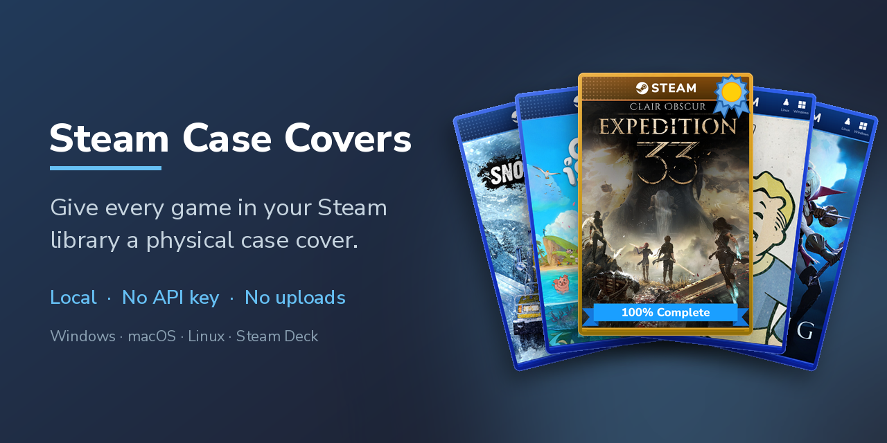
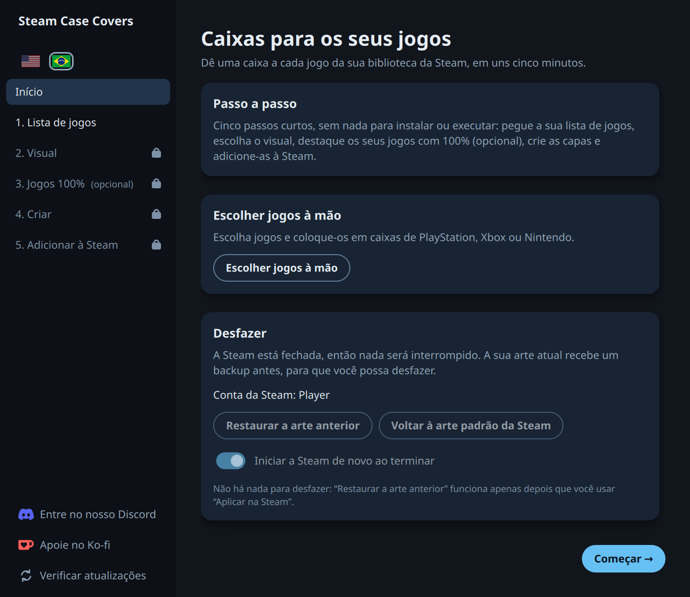
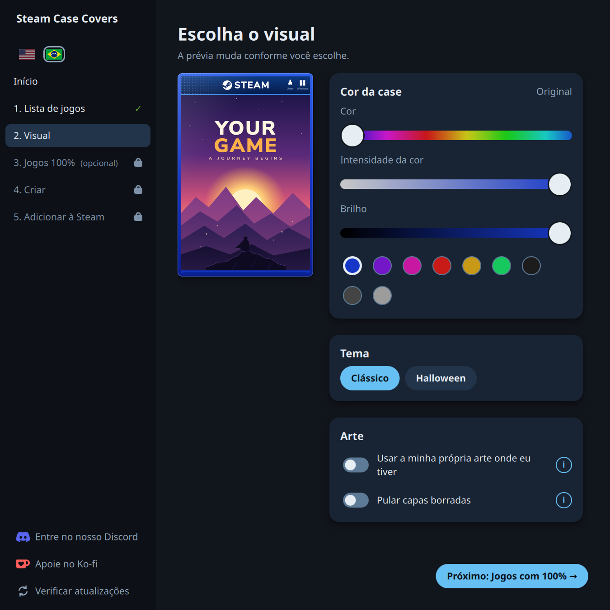
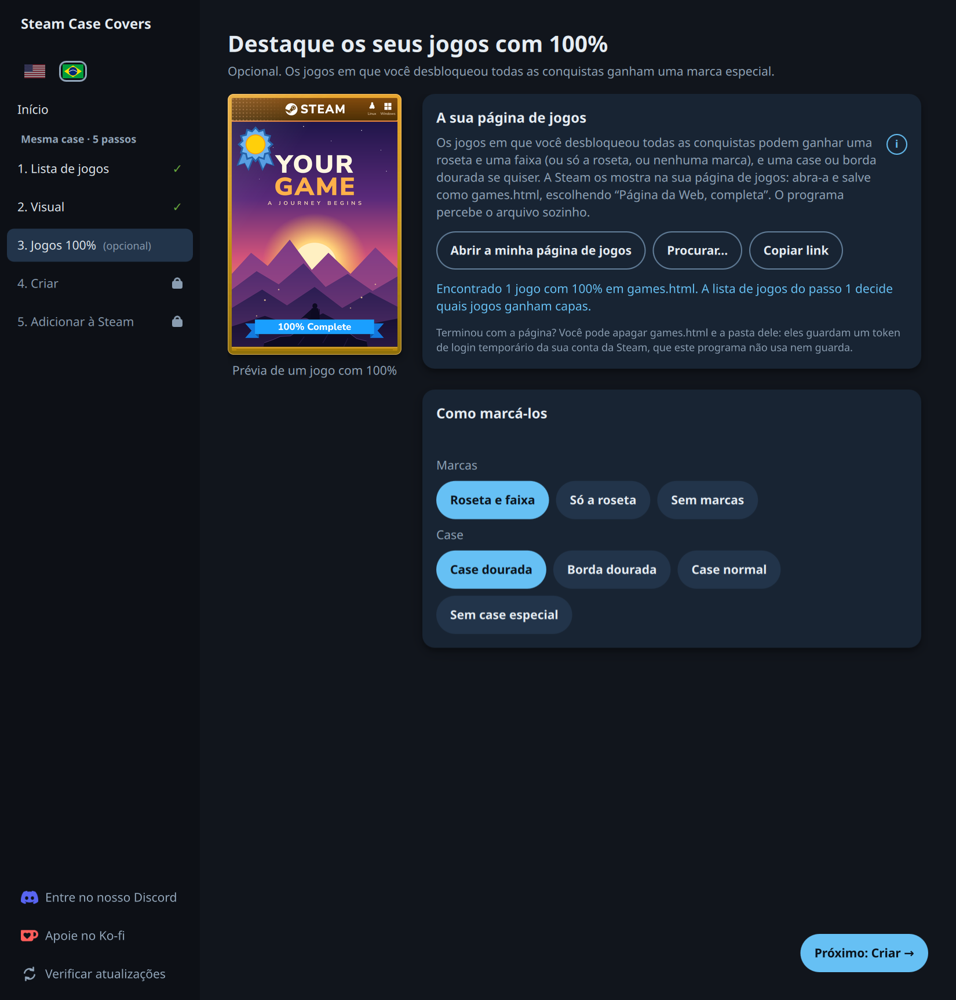
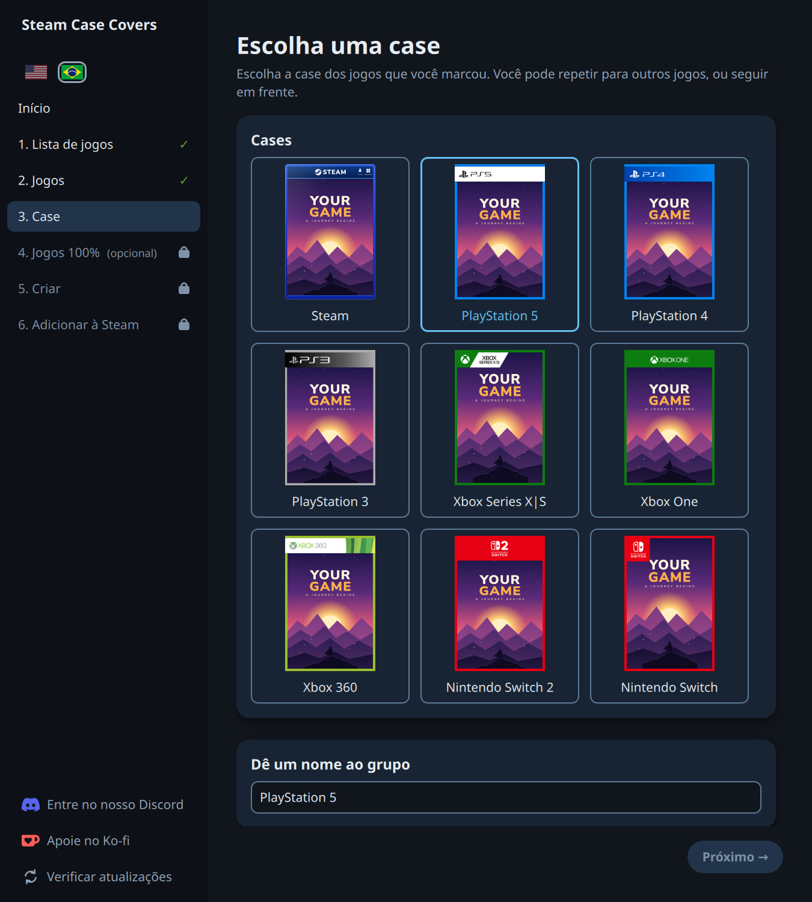
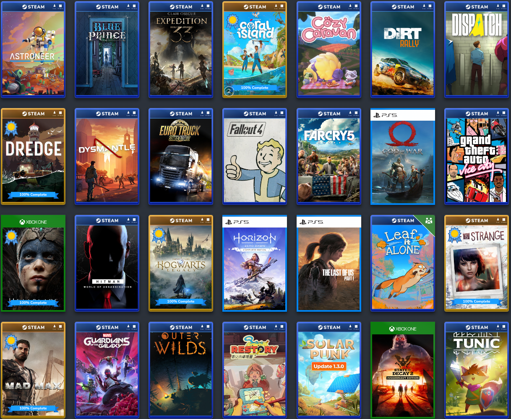
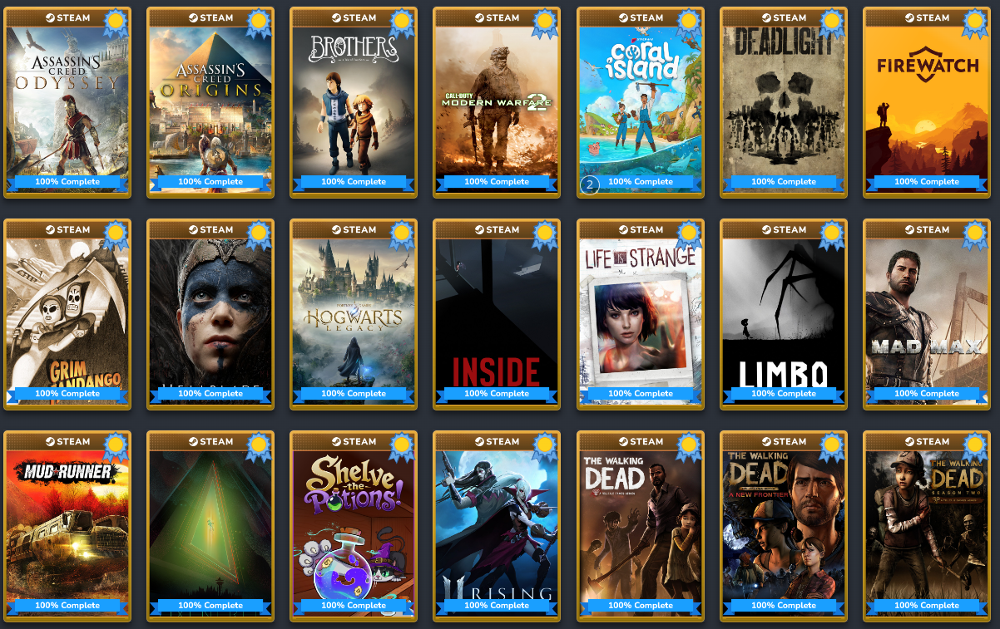
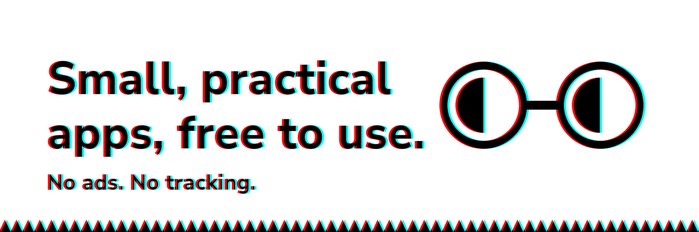

<p align="center">
  <a href="README.md"></a> &nbsp;
  <a href="README.pt-BR.md"></a>
</p>

<p align="center">
  <a href="https://github.com/diegobergonsi/steam-case-covers/raw/main/assets/preview.png"></a>
</p>

<h1 align="center">steam-case-covers</h1>

<p align="center">
  Dê a cada jogo da sua biblioteca da Steam uma capa de "case de jogo de verdade".<br>
  Tudo roda no seu computador: sem login, sem chave de API, sem envio de nada.
</p>

<p align="center">
  <a href="https://github.com/diegobergonsi/steam-case-covers/releases"><b>BAIXAR</b></a> ·
  <a href="https://discord.gg/JQMjAPWHCT"><b>DISCORD</b></a>
</p>

<p align="center">
  <a href="#install">Instalação</a> ·
  <a href="#how-it-works">Como funciona</a> ·
  <a href="#features">Recursos</a> ·
  <a href="#safety">Segurança</a> ·
  <a href="#steam-compatibility">Compatibilidade com a Steam</a> ·
  <a href="#command-line">Linha de comando</a> ·
  <a href="#faq">Perguntas frequentes</a> ·
  <a href="#feedback-and-bugs">Sugestões e bugs</a> ·
  <a href="#support-the-project">Apoio</a>
</p>

<table align="center">
  <tr>
    <td align="center"><a href="https://github.com/diegobergonsi/steam-case-covers/raw/main/assets/screenshot-home-pt.png"></a><br><sub>Início</sub></td>
    <td align="center"><a href="https://github.com/diegobergonsi/steam-case-covers/raw/main/assets/screenshot-look-pt.png"></a><br><sub>1. Escolha o visual</sub></td>
  </tr>
  <tr>
    <td align="center"><a href="https://github.com/diegobergonsi/steam-case-covers/raw/main/assets/screenshot-100-pt.png"></a><br><sub>2. Destaque os seus jogos com 100%</sub></td>
    <td align="center"><a href="https://github.com/diegobergonsi/steam-case-covers/raw/main/assets/screenshot-cases-pt.png"></a><br><sub>3. Ou escolha uma case de console à mão</sub></td>
  </tr>
</table>

<p align="center">
  <em>O programa inteiro: Início e depois cinco passos curtos, sem terminal. A prévia acompanha cada escolha.</em>
</p>

<p align="center">
  <em>
    Este projeto não é afiliado à Valve Corporation, à Microsoft nem a nenhuma publicadora de jogos.
    Steam e Windows são marcas registradas dos seus respectivos donos. Veja <a href="docs/THIRD_PARTY.md">THIRD_PARTY.md</a> (em inglês).
  </em>
</p>

## O que é?

Cada jogo na sua biblioteca Steam aparece como uma arte vertical. Esta ferramenta coloca essa arte dentro de uma "case" (azul por padrão, ou em qualquer cor e tom que você escolher, do vivo ao cinza-escuro e ao preto) com uma faixa da Steam e os ícones das plataformas, como se fosse um jogo físico de console, e instala o resultado como a sua arte personalizada.

A arte vem dos próprios servidores da Steam. As capas são criadas no seu computador e ficam nele.

<p align="center">
  <a href="https://github.com/diegobergonsi/steam-case-covers/raw/main/assets/library-mixed.png"></a>
  <br>
  <em>Como as capas ficam dentro da Steam: a case da Steam, cases de console (God of War, Horizon Zero Dawn e The Last of Us em cases de PlayStation 5, Hellblade e State of Decay 2 em cases de Xbox One) e jogos com 100% com roseta, alguns com a opção de borda dourada. Leaf it Alone vem da biblioteca de alguém da família, por isso tem o canto verde. Coral Island está nas duas bibliotecas, por isso não tem (o pequeno “2” é um selo da própria Steam).</em>
</p>

<a id="install"></a>

## 📥 Instalação

<details>
<summary><b>Windows</b></summary>

Baixe o `SteamCaseCovers-windows.exe` na [página de Releases](https://github.com/diegobergonsi/steam-case-covers/releases/latest) e dê dois cliques nele.

Se aparecer "O Windows protegeu o seu PC", clique em **Mais informações** e depois em **Executar assim mesmo**. O programa não tem assinatura de código (isso custa dinheiro), e é por isso que o Windows avisa. Alguns antivírus também marcam programas deste tipo.

</details>

<details>
<summary><b>macOS</b></summary>

Baixe o `SteamCaseCovers-macos.zip` na [página de Releases](https://github.com/diegobergonsi/steam-case-covers/releases/latest) e dê dois cliques para descompactar. **Antes de abrir o programa**, rode isto no **Terminal** (mude o caminho se o programa não estiver em Downloads) e só então dê dois cliques no programa:

```bash
xattr -dr com.apple.quarantine ~/Downloads/SteamCaseCovers.app
```

Por quê: o macOS bloqueia qualquer programa que não venha de um desenvolvedor Apple pago (cerca de 99 dólares por ano, o que um projeto gratuito não justifica). Esse comando tira a marca de "baixado da internet", e o macOS abre o programa normalmente. O programa não é nocivo nem está danificado, e o código-fonte está aqui para qualquer pessoa ler.

Se você abrir o programa primeiro, o macOS mostra **"SteamCaseCovers" não foi aberto: a Apple não conseguiu verificar se está livre de malware**. Clique em **Concluído** (não em Mover para o Lixo), depois abra os **Ajustes do Sistema**, **Privacidade e Segurança**, role até **Segurança** e clique em **Abrir Mesmo Assim** ao lado da mensagem do SteamCaseCovers (ela fica por cerca de uma hora; dê dois cliques no programa de novo para ela voltar). Se depois disso o programa ficar pulando no Dock para sempre, sem janela, **reinicie o Mac** e use o comando do Terminal acima. No macOS 14 ou mais antigo, você também pode clicar no programa com o botão direito e escolher **Abrir**.

Na primeira vez que você apertar **Aplicar na Steam**, o macOS pode dizer que o programa não tem permissão para controlar a Steam. Permita no aviso (ou em **Ajustes do Sistema**, **Privacidade e Segurança**) e aperte o botão de novo.

O suporte ao macOS é **no melhor esforço**: o autor só testou num MacBook Air com Apple Silicon. A versão é para Apple Silicon (M1 ou mais novo). Num Mac Intel, rode [a partir do código](#from-source).

</details>

<details>
<summary><b>Linux e Steam Deck</b></summary>

No Steam Deck, mude primeiro para o **Modo Desktop**. O programa precisa de uma janela de desktop, e por isso ele não roda no Modo Jogo.

Baixe o `SteamCaseCovers-linux` na [página de Releases](https://github.com/diegobergonsi/steam-case-covers/releases/latest) e abra. No Steam Deck aparece um pequeno aviso: clique em **Launch** e o programa abre.

Se o seu gerenciador de arquivos não o executar, torne-o executável e o inicie pelo terminal:

```bash
chmod +x SteamCaseCovers-linux
./SteamCaseCovers-linux
```

</details>

<details id="from-source">
<summary><b>A partir do código (qualquer sistema)</b></summary>

Se você prefere não confiar num download, rode a partir do código. É preciso Python 3.10 ou mais novo, Pillow 10.3 ou mais novo e PySide6 (Qt). As versões publicadas e os testes automáticos usam Python 3.12.

```bash
git clone https://github.com/diegobergonsi/steam-case-covers
cd steam-case-covers
python -m pip install -r requirements-qt.txt
python -m qtui
```

No macOS e no Linux, use `python3` em vez de `python`. Rode os testes com `QT_QPA_PLATFORM=offscreen python -m unittest discover -s tests` (no PowerShell do Windows, rode antes `$env:QT_QPA_PLATFORM="offscreen"`). `python -m qtui --selftest` monta a janela sem mostrar ela.

</details>

Os arquivos de cada versão vêm com uma lista `SHA256SUMS` para você conferir o que baixou. Veja [SECURITY.md](docs/SECURITY.md) (em inglês).

<a id="how-it-works"></a>

## 🔧 Como funciona

1. **Pegue a sua lista de jogos.** Clique em **Abrir a página no meu navegador**. O navegador abre a Steam: entre na sua conta se pedir, e você vai cair numa página de texto simples. Salve ela (Ctrl+S, ou Cmd+S no Mac) como `userdata.json`. O programa percebe o arquivo sozinho pelo nome. O navegador não abriu? Clique em **Copiar link** e cole você mesmo. Ou selecione **Só os meus jogos instalados** para pular este passo: os jogos que não estão instalados no computador, inclusive os compartilhados por alguém da família, ficam de fora (passe o mouse no **i** ao lado). No Mac com Safari, escolha o formato **Código-Fonte da Página** ao salvar (ou use Chrome ou Firefox).
2. **Escolha o visual.** Escolha o visual das cases: arraste os controles de Cor, Intensidade da cor e Brilho ou toque numa das nove amostras (seis cores, depois Preto, Grafite e Prata), e a prévia mostra o resultado. A Intensidade da cor e o Brilho só descem a partir do azul original, então a case pode ter qualquer tom, do vivo ao cinza-escuro e ao preto; o logo e o texto brancos continuam brancos. O **Tema** pode transformar as cases numa de **Halloween**: uma teia com uma aranha, uma abóbora e uma aranha pendurada no alto, por cima da cor que você escolheu. A case de Halloween mostra só a roseta nos seus jogos com 100% (a faixa esconderia os enfeites), e a janela escolhe isso por você. Se você definiu a sua própria arte para alguns jogos (no menu da Steam ou pelo SteamGridDB), selecione **Usar a minha própria arte onde eu tiver** e a sua arte vai para dentro da case no lugar da arte da Steam; os jogos sem arte sua ficam com a da Steam. O programa guarda uma cópia da sua arte na pasta dele e nunca muda os seus arquivos.
3. **Destaque os seus jogos com 100% (opcional).** Carregue a sua página de jogos da Steam e os jogos em que você desbloqueou todas as conquistas ganham uma marca. Detalhes mais abaixo. Você pode pular este passo.
4. **Crie as capas.** Confira as suas escolhas (cada uma leva de volta ao seu passo) e clique em **Criar capas**, depois espere. Você pode cancelar e rodar de novo mais tarde: as capas prontas são mantidas, então ele continua de onde parou. Se você já criou capas em outra cor ou tema, o programa pergunta antes de substituí-las.
5. **Adicione-as à Steam.** Clique em **Aplicar na Steam**. Se houver mais de uma conta da Steam no computador, a janela mostra qual será alterada; escolha outra com os botões de conta. A sua arte atual é copiada para um backup antes.

> [!WARNING]
> O passo 5 **fecha a Steam para você** (qualquer jogo aberto para e os downloads pausam), adiciona as capas e inicia a Steam de novo. Salve o seu jogo antes. O programa pergunta antes de fazer qualquer coisa.

Mudou de ideia? Logo depois do passo 5, aperte **Desfazer** no cartão Pronto. Mais tarde, use o **Início** (a primeira entrada da lista à esquerda), onde um cartão Desfazer aparece quando há algo para desfazer:

* **Restaurar a arte anterior** desfaz o último Aplicar. Aperte de novo para voltar mais um passo.
* **Voltar à arte padrão da Steam** remove as capas que este programa criou. Funciona mesmo que você não tenha backup. Se ele também encontrar arte personalizada que este programa não criou (do SteamGridDB, ou definida à mão na Steam), ele pergunta se deve remover essa também: **Remover só as capas deste programa** a mantém, **Remover todas** traz de volta a arte da própria Steam em todo lugar. Restaurar desfaz qualquer um dos dois.

### Opcional: escolher jogos à mão, em cases de console ou numa cor sua

Alguns jogos pertencem a outra case: The Last of Us é um jogo de PlayStation, Forza é um jogo de Xbox. No **Início**, o cartão **Escolha os jogos e as cases** abre um segundo caminho pela janela (o outro cartão, a mesma case para todos os jogos, continua como está). Depois da sua lista de jogos, você marca os jogos que quer (procure pelo nome, ou role a lista) e escolhe uma case para eles: **PlayStation 5, 4 ou 3, Xbox Series X|S, Xbox One ou Xbox 360, Nintendo Switch ou Switch 2**, ou a case da Steam, que aqui pode ter uma cor própria (azul, violeta, magenta, vermelho, dourado, verde, preto, grafite ou prata). Você pode marcar mais jogos e dar a eles outra case, ou seguir em frente. Os jogos que você não marca ficam como estão (as capas deles não mudam), e **Criar** e **Adicionar à Steam** funcionam como antes, só para os jogos que você marcou.

* As cases de console são fixas: sem cor, brilho nem tema. Elas são desenhadas para preencher o mesmo cartão alto da case da Steam.
* **Sua própria case.** Faça uma case você mesmo e use ela: **Minha própria case**, no fim da lista de cases. É um PNG de **600 x 900 pixels**, transparente onde a arte do jogo vai (pelo menos 400 x 400), como as cases de console, e o programa acha a parte transparente sozinho. Você escolhe o arquivo cada vez que quer uma case nova, e a última fica guardada para você refazer as capas. O passo **Visual** do passo a passo tem a mesma escolha e usa a case em todos os jogos; cor, tema e dourado não valem para ela.
* **Grupos.** Os jogos a que você dá uma case entram num **grupo** com um nome que você pode mudar ("Jogos largados", "Xbox 360"), e o programa lembra dele. Da próxima vez você pode adicionar jogos a um grupo que criou, ou apagá-lo. Um jogo fica em um grupo só. As cores são só visual: o dourado é uma cor como as outras, e a roseta e a faixa só vão em jogos que realmente estão com 100% na página de jogos que você carregou.
* **O caminho de sempre deixa os seus grupos em paz.** Quando você cria capas de novo pelo cartão **A mesma case para todos os jogos da sua lista**, as capas dos seus grupos não são repintadas. No passo **Criar** você pode marcar um grupo para repintar as capas dele com o visual que escolheu; isso apaga o grupo. **Voltar à arte padrão da Steam** (no Início) funciona do mesmo jeito: ele deixa os seus grupos na Steam, a não ser que você os marque.
* Os jogos compartilhados pelo Compartilhamento em Família da Steam só ganham o canto verde se você selecionar **Marcar os jogos da família com um canto verde** (isso precisa do arquivo da sua lista de jogos).
* Os seus jogos com 100% ganham a roseta e a faixa (ou só a roseta) se você carregar a sua página de jogos no passo **Jogos 100%** deste caminho e mantiver **Destacar**.
* O caminho de sempre nunca muda nem remove uma capa de console: só escolher o jogo de novo aqui faz isso.
* Os logos de PlayStation, Xbox e Nintendo pertencem aos seus donos, e este projeto não é afiliado a eles. Veja [THIRD_PARTY](docs/THIRD_PARTY.md) (em inglês).

### Opcional: destacar os seus jogos com 100%

O passo 3, **Destaque os seus jogos com 100%**, é opcional. Os jogos em que você desbloqueou todas as conquistas ganham uma roseta no canto superior esquerdo, logo abaixo da faixa, e uma faixa "100% Complete" na parte de baixo (você pode ficar só com a roseta). Funciona como o passo 1: o programa não consegue ver as suas conquistas sozinho, então você salva mais uma página pelo seu próprio navegador.

<p align="center">
  <a href="https://github.com/diegobergonsi/steam-case-covers/raw/main/assets/library-100.png"></a>
  <br>
  <em>Jogos completados com 100%, com a opção de case dourada.</em>
</p>

1. Clique em **Abrir a minha página de jogos** (ou **Copiar link**). O navegador abre a sua página de jogos da Steam, ordenada por conquistas. Entre na sua conta se pedir e espere os seus jogos carregarem.
2. Salve ela (Ctrl+S, ou Cmd+S no Mac) como **"Página da Web, completa"** no Chrome ou no Firefox, com o nome `games.html`. O navegador também salva uma pasta ao lado. O programa percebe o arquivo na sua pasta Downloads sozinho, ou você pode clicar em **Procurar…** e escolhê-lo.
3. Escolha o que esses jogos ganham: **Roseta e faixa** (a roseta no canto superior esquerdo e a faixa "100% Complete" embaixo; é o padrão), **Só a roseta** (só a roseta, sem faixa sobre a arte) ou **Sem marcas** (nada na capa: escolha junto com **Case dourada** ou **Borda dourada** e só o dourado mostra que o jogo está em 100%).
4. Escolha como esses jogos ficam: **Case dourada** (a case inteira fica dourada), **Borda dourada** (uma borda dourada por fora da case, que fica cerca de 5% menor), **Case normal** (a sua case continua como está; é o padrão depois que uma página é carregada) ou **Sem case especial** (nenhum destaque, então as marcas não se aplicam). As opções só podem ser escolhidas depois que uma página é carregada. Depois clique em **Criar capas**.

> [!NOTE]
> A página salva contém um token de login temporário da sua conta da Steam. O programa só lê quais jogos estão com 100%: ele nunca usa, guarda nem registra o token. Você pode apagar o `games.html` e a pasta dele depois que as capas estiverem criadas. O programa nunca apaga os seus arquivos sozinho.

Bom saber:

* Só os jogos que já estão na sua lista do passo 1 podem ser destacados.
* A página da Steam só mostra progresso dos jogos em que você desbloqueou pelo menos uma conquista. Por isso só os jogos com 100% são marcados: não há marcas para jogos que você só começou.
* Trocar a escolha, ou salvar a página de novo depois de terminar outro jogo e clicar em **Criar capas**, refaz só as capas que mudam. Se você criar capas sem carregar uma página, as capas que já estão destacadas mantêm o destaque.
* A página lista a maior parte de uma biblioteca, mas não toda. Na biblioteca do autor, ela listou cerca de 99% das capas (509 de 515): alguns jogos antigos, gratuitos ou ocultos não estão nela e não podem ser destacados.
* Isto só foi testado com o Chrome, no Linux, com a Steam em português e em inglês; as páginas salvas deram exatamente o mesmo resultado. Espera-se que o Firefox salve a página do mesmo jeito, e o programa lê o progresso sem depender do idioma do texto da Steam, mas outros idiomas e navegadores não foram testados. O Windows e o macOS também não foram testados, nem uma tela de toque de verdade.

<a id="features"></a>

## ✨ Recursos

**Capas**
- Para os seus jogos instalados, ou para a biblioteca inteira
- Cada capa é o retrato do próprio jogo dentro de uma case, com a faixa da Steam e os ícones das plataformas
- Os jogos compartilhados pelo Compartilhamento em Família da Steam também ganham capas, com um canto verde e um ícone de família
- Opção de "pular capas borradas" para jogos que a Steam não tem um retrato de verdade

**Deixe do seu jeito**
- Escolha jogos à mão e coloque-os numa case de PlayStation, Xbox ou Nintendo, ou numa cor sua, em grupos que o programa lembra
- Se quiser, coloque a arte que você mesmo definiu (no menu da Steam ou do SteamGridDB) dentro da case, para os jogos que a têm
- Escolha a cor, a intensidade da cor e o brilho das cases com três controles ou uma amostra pronta (inclusive preto, grafite e prata), com prévia ao vivo e, se quiser, um tema de Halloween (uma teia com uma aranha, uma abóbora e uma aranha pendurada) em qualquer cor
- Opcional: os jogos em que você desbloqueou todas as conquistas ganham uma roseta e uma faixa "100% Complete" (ou só a roseta) e, se quiser, uma case dourada ou uma borda dourada ([como funciona](#optional-highlight-your-100-games))

**Instale com segurança**
- Um clique: a Steam é fechada com educação, recebe backup, é atualizada e reiniciada
- Desfazer passo a passo, e uma volta à arte padrão da Steam
- Cancele quando quiser; rode de novo para continuar
- Várias contas da Steam num computador: você escolhe qual recebe as capas

**O programa em si**
- Funciona com o teclado, ajusta-se a telas de alta resolução e cabe em telas pequenas como a do Steam Deck; botões e controles têm tamanho de dedo (44 px) para telas de toque, e as cores seguem a regra de contraste recomendada (WCAG 2.2 nível AA)
- Inglês e português do Brasil: o programa começa no idioma do seu sistema, e duas bandeirinhas embaixo do nome trocam o idioma quando você quiser (a linha de comando continua em inglês)
- Um botão "Verificar atualizações", só quando você clica: ele pergunta ao GitHub qual é a versão mais nova e nunca baixa nem instala nada
- Software livre: sem anúncios, sem conta, sem telemetria

<a id="safety"></a>

## 🔒 Segurança

* Ele só mexe nos arquivos de retrato (`<appid>p.png`, e os `.jpg`, `.jpeg` ou `.webp` que esconderiam uma capa) na pasta `config/grid` da sua conta da Steam. Tudo o que ele move fica guardado no backup. Ele nunca toca nos seus jogos nem nos seus saves.
* Antes de cada mudança ele faz um backup exatamente do que vai mudar, grava os arquivos de forma atômica e desfaz tudo se algo falhar.
* Duas janelas abertas não conseguem mexer na pasta da Steam ao mesmo tempo.
* Ele nunca faz login, nunca pede senha nem chave de API, nunca envia nada e nunca roda com permissões elevadas.
* Os arquivos que ele lê da internet têm tamanho limitado e são conferidos antes do uso.

Se você encontrar um problema de segurança, por favor [avise em particular](docs/SECURITY.md).

<a id="steam-compatibility"></a>

## 🎮 Compatibilidade com a Steam

✅ Linux e SteamOS (Steam em `~/.local/share/Steam`) <br>
✅ Windows: uma versão antiga (0.9.11) foi testada por um colega do autor num PC de verdade; as versões mais novas, inclusive os controles de cor e o canto de família, são cobertas só pelos testes automáticos <br>
🟡 macOS: testado num Mac com Apple Silicon (no melhor esforço)

> [!NOTE]
> Se algo não funcionar no seu sistema, conte para a gente no [Discord](https://discord.gg/JQMjAPWHCT) (ou [abra uma issue](https://github.com/diegobergonsi/steam-case-covers/issues)) com o seu sistema e o que você viu. Retornos de quem usa Windows e macOS são especialmente bem-vindos.

<a id="command-line"></a>

## 💻 Linha de comando

Tudo o que a janela faz também está disponível num terminal:

```bash
python -m engine make --library userdata.json   # build covers
python -m engine make --library userdata.json --hue 134   # ...in another case colour (0 to 359 degrees; 0 is the original blue)
python -m engine make --library userdata.json --brightness 0   # ...a black case (0 to 100; 100 is the original)
python -m engine make --library userdata.json --saturation 0 --brightness 60   # ...a grey case (--saturation also goes 0 to 100)
python -m engine make --library userdata.json --theme halloween   # ...with the Halloween theme (the case keeps its colour; --theme classic goes back)
python -m engine make --library userdata.json --games-page games.html   # ...with a rosette and a ribbon on your 100% games
python -m engine make --library userdata.json --use-custom-art   # ...with the art you set yourself inside the case, for the games that have it
python -m engine make --library userdata.json --games-page games.html --completed-style gold-case   # ...also in a gold case (or gold-border)
python -m engine make --library userdata.json --games-page games.html --completed-marks rosette   # ...with the rosette only, no ribbon
python -m engine make --library userdata.json --completed-style none   # ...and back to plain covers for 100% games
python -m engine apply --close-steam            # install them
python -m engine restore                        # undo the last apply
python -m engine reset                          # back to Steam's default art
python -m engine reset --everything             # ...also removing art from other sources
```

A linha de comando fala inglês (os comentários acima são do próprio comando). O que cada comando faz:

| Comando | O que faz |
|---|---|
| `list` | Mostra os jogos que ele encontrou |
| `make` | Cria as capas em `./covers` |
| `apply` | Copia as capas para a Steam, com backup |
| `run` | `make` e depois `apply` |
| `restore` | Desfaz o último apply (rode de novo para voltar mais um) |
| `reset` | Remove da Steam as capas que este programa criou (`--everything` também remove arte personalizada de outras origens) |

O `list` marca com `(family)` os jogos da sua biblioteca de Família da Steam. O `make` mantém a cor das capas que já estão na pasta, a não ser que você passe `--hue`, `--saturation` ou `--brightness`; uma opção que você deixa de fora mantém o valor das capas que já estão lá, ou o original (`--hue 0 --saturation 100 --brightness 100` pede o azul original). O `--use-custom-art` coloca a arte que você mesmo definiu dentro da case, para os jogos que a têm (use `--user` com `make` para escolher a conta); o `--no-custom-art` volta ao retrato da Steam em todas as capas; sem nenhum dos dois, as capas já feitas com a sua arte continuam com ela. O `--theme` é `classic` ou `halloween`, e sem ele as capas que já estão na pasta mantêm o tema; com o tema de Halloween, os jogos com 100% ganham só a roseta, então `--completed-marks full` é recusado. A saturação e o brilho vão de 0 a 100, onde 100 é o original e valores menores dão uma case mais cinza ou mais escura. O `--case-file FILE` coloca todos os jogos da execução em uma case sua (um PNG de 600 x 900, transparente onde a arte vai). Ele não pode ser usado junto com `--hue`, `--saturation`, `--brightness`, `--theme` nem com os estilos dourados, e um `make` seguinte sem ele deixa essas capas como estão (use outro `--out`, ou apague elas).

O `--games-page FILE` é a página de jogos salva como "Página da Web, completa" (veja [acima](#optional-highlight-your-100-games)). O `--completed-style` é `ribbon` (a case normal; é o padrão quando você passa uma página), `gold-case`, `gold-border` ou `none`; o `none` remove o destaque das capas feitas antes. O `--completed-marks` é `full` (a roseta e a faixa, o padrão), `rosette` (só a roseta) ou `none` (sem marcas: com `gold-case` ou `gold-border`, só o dourado) e funciona com todos os estilos, menos `none`. Sem nenhuma das duas opções, as capas mantêm o visual que têm.

Rode `python -m engine -h` para ver todas as opções, como `--only`, `--hue`, `--saturation`, `--brightness`, `--skip-auto-art`, `--steam-dir` e `--user` (o número da pasta da conta dentro de `userdata` da Steam, para escolher uma entre várias contas).

<a id="faq"></a>

## ❓ Perguntas frequentes

<details>
<summary><b>Ele diz que a minha lista de jogos está vazia</b></summary>

Você não estava logado na Steam no seu navegador quando salvou a página. Nesse caso a Steam não mostra erro; ela devolve uma lista vazia. Clique em **Abrir a página no meu navegador** de novo: ele abre primeiro a página de login da Steam, então entre lá e depois salve a página em que você cair. Se a página não mostrar jogos mesmo você tendo acabado de entrar, atualize ela (F5, ou Cmd+R no Mac) antes de salvar.

</details>

<details>
<summary><b>Por que algumas capas ficam borradas?</b></summary>

Muitos jogos antigos ou menores não têm um retrato de verdade na Steam. A Steam monta um substituto a partir da imagem larga do cabeçalho, então o banner do título fica no meio de uma cópia borrada de si mesmo. Selecione **Pular capas borradas** (passe o mouse no **i** ao lado) para deixar esses jogos em paz.

</details>

<details>
<summary><b>Eu defini arte personalizada à mão na Steam. Estas capas vão substituir ela?</b></summary>

A Steam mostra a arte que você definiu à mão (ou pegou do SteamGridDB) antes destas capas. O **Aplicar na Steam** move essa arte dos jogos cobertos para o backup, para a case aparecer, e **Restaurar a arte anterior** a traz de volta. Para limpar tudo isso e ficar com a arte da própria Steam, use **Voltar à arte padrão da Steam** e escolha **Remover todas**.

</details>

<details>
<summary><b>Onde as capas ficam guardadas?</b></summary>

Na sua própria pasta de usuário: `~/.local/share/steamcase/covers` no Linux, `%LOCALAPPDATA%\steamcase\covers` no Windows e `~/Library/Application Support/steamcase/covers` no macOS. Use **Abrir a pasta das capas** no programa. As cópias da Steam ficam em `userdata/<id>/config/grid`; copie essa pasta para usar as capas em outro computador.

</details>

<details>
<summary><b>Um jogo da biblioteca da minha família não ganhou capa</b></summary>

Os jogos compartilhados com você pelo Compartilhamento em Família da Steam não estão na sua própria lista de jogos, então o programa precisa comparar os arquivos da própria Steam com a sua lista para distingui-los. Desmarque **Só os meus jogos instalados** e carregue a sua lista de jogos (**Abrir a página no meu navegador**, ou **Procurar…** até um `userdata.json` mais antigo: ele não precisa conter o jogo compartilhado). Os jogos compartilhados ganham então capas com um canto verde. Se a lista for antiga, jogos que você comprou depois de salvar ela podem ser confundidos com compartilhados, então salve ela de novo depois de comprar jogos. Isto só foi testado numa família pequena: por favor [abra uma issue](https://github.com/diegobergonsi/steam-case-covers/issues) se faltarem jogos.

</details>

<details>
<summary><b>O que acontece se eu mudar a cor depois de criar as capas?</b></summary>

Quando você clica em **Criar capas**, o programa pergunta antes de substituir as capas que você já criou em outra cor, tom ou tema de case. Se você disser que sim, ele refaz todas no visual novo, o que baixa a arte de novo. A Steam continua mostrando a sua arte atual até você adicionar as capas novas no passo 5, e **Restaurar a arte anterior** pode desfazer isso. Existe um conjunto de capas por vez. Só o azul original foi conferido para texto legível: faixas amarelo-vivo ou verde-limão deixam o texto branco mais difícil de ler, e o mesmo pode acontecer com uma case muito clara.

</details>

<details>
<summary><b>Por que a página de jogos precisa ser salva como "Página da Web, completa"?</b></summary>

A Steam monta essa página no seu navegador depois que ela carrega. "Página da Web, somente HTML" salva só a primeira resposta da Steam, que traz apenas os 20 jogos que você jogou mais recentemente e nenhuma linha de jogo, então o programa não acha nada para ler e avisa. "Página da Web, completa" salva a página como ela aparece na tela, com todos os jogos. Ela também salva uma pasta de imagens (cerca de 90 MB para uma biblioteca grande) de que o programa não precisa.

</details>

<details>
<summary><b>Posso remover os destaques depois?</b></summary>

Pode. Carregue uma página de novo (ou qualquer página), escolha **Sem case especial** e clique em **Criar capas**: o programa pergunta antes e refaz as capas destacadas como capas normais. Na linha de comando, use `--completed-style none`. Adicione as capas à Steam de novo no passo 5 para ver a mudança lá.

</details>

<details>
<summary><b>O que acontece quando eu termino outro jogo?</b></summary>

Salve a sua página de jogos de novo (mesmo nome, do mesmo jeito), escolha o arquivo novo com **Procurar…** no bloco da página de jogos (o programa só vigia a pasta Downloads enquanto nenhuma página está carregada) e clique em **Criar capas**. Só as capas que mudam são refeitas.

</details>

<details>
<summary><b>Funciona para jogos fora da Steam e atalhos?</b></summary>

Ainda não. Só jogos da sua biblioteca da Steam.

</details>

<details>
<summary><b>Posso pegar as capas sem rodar o programa?</b></summary>

As capas que eu já fiz estão no SteamGridDB: <https://www.steamgriddb.com/profile/76561198040695197/grids/1>.

</details>

<details>
<summary><b>Leitores de tela são compatíveis?</b></summary>

Não. A janela funciona por completo com o teclado (Tab, Espaço, Enter), mas o conjunto de ferramentas que ela usa não consegue falar com leitores de tela. A linha de comando é a alternativa acessível.

</details>

<a id="feedback-and-bugs"></a>

## 💬 Sugestões e bugs

<p align="center">
  <a href="https://discord.gg/JQMjAPWHCT"></a>
</p>

As sugestões e os relatos de bugs são tratados principalmente no **[Discord](https://discord.gg/JQMjAPWHCT)** do projeto; **Entre no nosso Discord**, no fim da lista à esquerda, também abre o convite. Conte o seu sistema (Windows, macOS, Linux ou Steam Deck), a versão que você usa (o link **Verificar atualizações** mostra) e o que você viu; uma captura de tela ajuda muito. Você também pode [abrir uma issue](https://github.com/diegobergonsi/steam-case-covers/issues) no GitHub, se preferir.

Problemas de segurança são a exceção: por favor [avise em particular](docs/SECURITY.md), não em público.

<a id="support-the-project"></a>

## ☕ Apoie o projeto

<p align="center">
  <a href="https://ko-fi.com/diegobergonsi">
    <picture>
      <source media="(prefers-color-scheme: dark)" srcset="assets/kofi-banner-dark.png">
      
    </picture>
  </a>
</p>

O Steam Case Covers é gratuito, e vai continuar gratuito: sem anúncios, sem conta, sem telemetria. Eu o faço no meu tempo livre. Se ele deixou a sua biblioteca mais bonita, você pode ajudá-lo a continuar crescendo:

<p align="center">
  <a href="https://ko-fi.com/diegobergonsi"></a>
</p>

É totalmente opcional. Dar uma estrela ⭐ no repositório e contar para um amigo ajudam igualmente.

A minha página do Ko-fi também cobre o [WakeDeck](https://wakedeck.app), outro programa pequeno que eu fiz.

## 🙏 Agradecimentos

Obrigado ao [SteamGridDB](https://www.steamgriddb.com) e à sua comunidade por tornarem fácil compartilhar arte personalizada da Steam, e aos autores do [Pillow](https://python-pillow.org), do [PyInstaller](https://pyinstaller.org), da fonte [Nunito Sans](https://fonts.google.com/specimen/Nunito+Sans) e do tema de ícones KDE Breeze. Os detalhes estão em [THIRD_PARTY.md](docs/THIRD_PARTY.md) (em inglês).

A arte de jogos mostrada acima pertence às suas publicadoras e desenvolvedoras. As capas que você gera contêm essa arte: guarde-as para uso pessoal.

## 📄 Licença

Copyright (C) 2026 Diego Bergonsi. Software livre sob a [Licença Pública Geral GNU v3 ou posterior](LICENSE) (em inglês): você pode usá-lo, mudá-lo e compartilhá-lo, e tudo o que você distribuir feito a partir dele precisa continuar aberto sob a mesma licença.
